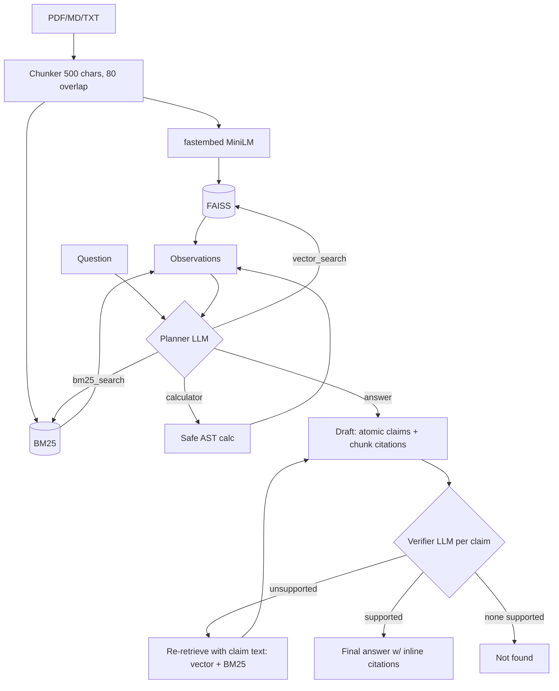

# End-to-End Agentic RAG

Local agentic RAG: ingest PDF/MD/TXT -> FAISS + BM25 -> an LLM agent picks tools -> drafts claims -> **verifies each claim against retrieved chunks** (re-retrieving if unsupported) -> final answer with inline citations, or "Not found".

## Setup
```bash
cd ./agentic-rag
python3 -m venv .venv && .venv/bin/pip install -r requirements.txt
.venv/bin/python -m agentic_rag.cli ingest data/sample      # builds ./index
```
Embeddings: `sentence-transformers/all-MiniLM-L6-v2` via **fastembed** (ONNX, no torch; downloaded once to the HF cache).

### LLM providers
| provider | when | config |
|---|---|---|
| `grok-cli` (default if `OPENAI_API_KEY` unset) | uses logged-in Grok CLI headless (`grok --no-auto-update -p ... --output-format json`), SuperGrok subscription, no key | `GROK_BIN`, `GROK_TIMEOUT` |
| `openai` (default if key set) | any OpenAI-compatible API | `OPENAI_BASE_URL` (default `https://api.x.ai/v1`), `OPENAI_API_KEY`, `MODEL` |

Override with `LLM_PROVIDER=...` or `--provider`. Web search is not included (no key).

## Usage
```bash
.venv/bin/python -m agentic_rag.cli ask "How long can biochar carbon persist in soil?" --trace
.venv/bin/streamlit run app.py          # http://localhost:8501
.venv/bin/pytest -q                     # offline, mocked LLM + hashing embedder
```
Note: each Grok CLI call takes ~30-70 s, a query needs ~4-6 calls.

## Architecture


## How verification works
1. The draft must be JSON: a list of atomic claims, each with chunk-id citations. Citations to ids that were never retrieved are stripped.
2. A separate strict fact-check prompt sees only the **cited** chunks (+ calculator results) and returns a supported/unsupported verdict per claim. A claim with no valid citation is unsupported regardless.
3. If any claim is unsupported (or there are no claims), each unsupported claim is used as a new query for both vector and BM25 search, new chunks are added, and the answer is redrafted and re-verified (`max_verify_rounds`, default 1).
4. Final answer keeps only verified claims, each followed by `[source#chunk]`; if none survive, it returns "Not found". The whole trace is shown in the CLI (`--trace`) and Streamlit.

## Layout
`agentic_rag/` (config, llm, ingest, tools, agent, cli) · `app.py` Streamlit · `tests/` · `data/sample/` (**original illustrative sample data, not authoritative**).


## Scope & Verification

- **Automated Tests**: `7 passed` via `pytest -q` using deterministic mocked LLM responses and a local hashing embedder.
- **Scope**: Demonstrates local hybrid retrieval (FAISS + BM25) and claim-level verification against retrieved chunks. Live LLM quality depends on the configured provider and corpus.
